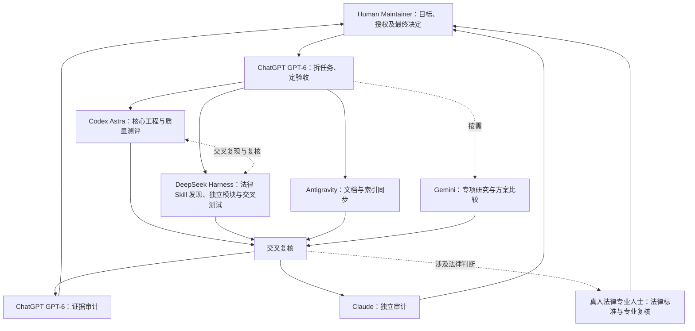

# AI Agent 开发与协作规范（V2.2）

本规范适用于 LexRouter 仓库的 AI Agent 与贡献者。实行 **单任务负责人（Single Owner）+ 交叉复核（Cross Review）+ 人工验收（Human Gate）**。角色分工不授权自动合并、修改冻结策略或替代真人专业签署。

## 角色权限

| 角色 | 核心责任 | 权限边界 |
| --- | --- | --- |
| Human Maintainer（人类维护者） | 目标与重大决策、法律专业判断及本人签署、授权接受、最终入库决定、PR 验收与合并 | AI 不得代签、代批或自动合并 |
| ChatGPT GPT-6 | 项目协调、任务书、范围和 DoD、PR 审计、Gate 验收建议 | 审计不等于法律结论或最终合并 |
| Claude（Anthropic） | 独立审计与交叉复核：对 PR、任务书、评测设计和 Run Artifacts 出具独立审计意见；对法律 Skill 内容做 AI 预审；对任务书和协作规范挑错 | 非 Owner；不合并、不代签、不修改冻结路线图；不运行第三方 Skill；不替代真人法律专业复核，AI 预审不等于法律结论；不接触密钥、Holdout 或未脱敏材料 |
| Codex Astra | 核心架构、复杂工程、评测引擎、CI、权限与签署安全、工程集成 | 不自行接受法律授权或签署专业意见 |
| DeepSeek Harness | 边界明确的代码与适配器、单测与回归测试、缺陷复现、中国法律 Skills 自动化发现 | 不擅改核心安全契约、不自动判定法源、授权或正式入库 |
| Antigravity | 文档编写、更新、索引、归档、交叉引用和版本一致性维护 | 不自行修改冻结路线、专业结论或正式 Schema |
| Gemini | 按需专项研究、方案比较、独立技术复核 | 非常驻工程负责人；遵守同一 PR Gate |

每项任务和 PR 必须指定唯一 Owner，另指定交叉复核与最终验收主体；研究与工程报告只构成证据，不自动产生权限。

## 多 Agent 工作分配

| 工作内容 | Owner | 复核／验收 |
| --- | --- | --- |
| 核心架构、评测引擎、静态路由代码 | Codex Astra | DeepSeek Harness 交叉测试、ChatGPT 审计 |
| Review Workbench、权限、真实事件同步与 CI 安全 | Codex Astra | DeepSeek Harness 负例与回归、ChatGPT 审计；真人单独签署 |
| 解析器、适配器、辅助 CLI 等隔离模块 | DeepSeek Harness | Codex Astra 工程复核、ChatGPT 审计 |
| 单元测试、缺陷复现、模块回归 | 模块开发 Owner | 另一工程 Agent 独立验证 |
| 中文法律 Skills Discovery（检索、归一化、去重） | DeepSeek Harness | Codex Astra 集成校验、ChatGPT 审计、必要时人工判断 |
| LexExamBench 评测集工程 | Codex Astra 主导；DeepSeek Harness 协作 | ChatGPT 审计；专业试题与标准由具备能力的人类复核；独立仓库规则另行适用 |
| 第三方 Skill 原版质量测试、对照实验与评级证据 | Codex Astra | DeepSeek Harness 独立复现；ChatGPT 与 Claude 分别审计测试设计、评分规则和运行证据；真人法律专业人士核对法律标准答案和专业评分；Human Maintainer 授权实际运行及发布 |
| 协作规范、权限与治理类文档（AGENTS.md、收录政策等） | 任务书指定的起草者 | Claude 独立审计；起草者或定标准者为 ChatGPT 时，不得仅由 ChatGPT 审计；Human Maintainer 最终决定 |
| 法律 Skill 内容 AI 预审（法规引用、逻辑一致性、风险提示） | 任务书指定的 Owner | Claude 独立预审，仅供专业人士参考；真人法律专业人士作出法律意见；AI 预审不写成真人批准 |
| 文档、任务书索引、项目阶段记录 | Antigravity | ChatGPT 复核，技术事实由模块 Owner 确认 |
| 研究、替代方案或独立方案评测 | Gemini（按需） | ChatGPT 整合，重大决策由 Human Maintainer 决定 |

任务书明确 Owner、审阅者、文件或接口范围、输入、输出、DoD、冻结边界、交接材料和 PR 链接。不以 Token 配额平分任务。并行工作应从最新 main 各自创建独立分支和 PR，不共享可写分支；涉及同一文件、Schema 或 Review 历史时，先由 ChatGPT 协调写入顺序、基准 commit 和交接。

### 独立审计规则

1. **定标准者不独审。** 凡由 ChatGPT 拆任务并制定验收标准的任务，除 ChatGPT 审计外，须另有 Claude（或 Human Maintainer 指定的其他非定标准者）出具独立审计意见。两份意见分别记录，不合并为一句"已审计"。
2. **审计意见格式。** 写明审计对象及基准 commit、检查范围、按严重程度排序的发现、未检查项和建议结论（通过 / 需修改 / 需人工决策）。审计意见只构成证据，不自动产生权限。
3. **分歧处理。** ChatGPT 与 Claude 的审计意见不一致时，任何一方不得单方裁定；原 Owner 在原 PR 回应，列出分歧点交 Human Maintainer 决定。
4. **Claude 的使用边界。** Claude 不担任 Owner，不执行第三方 Skill 评测，不提交合并或代签。Claude 不保留会话间状态，依靠任务书、基准 commit 和 PR 记录工作。由 Human Maintainer 或 ChatGPT 在任务书中指定其审计范围，审计结果以 PR 评论或报告提交。

## 最新协作流程与三项独立任务（2026-11-04）

**Phase 1 三项任务分别验收，不互相代替：**

1. **发现（Discovery）**：DeepSeek Harness 检索、去重和保存来源证据；Codex Astra 校验适配器和集成，ChatGPT 审计。发现候选不代表经过质量测试或获准入库。每周 Search/Fetch 自动调度仍须单独授权和验证。
2. **质量测试（Evaluation）**：Codex Astra 固定第三方 Skill 原作者版本，准备或运行控制变量 A/B 测试，DeepSeek Harness 独立复现。真人法律专业人士核对法律标准答案、法规时效和专业评分；ChatGPT 与 Claude 分别审计测试设计、运行证据与评级规则，两份审计意见分别记录。**仅在运行权限已确认、真实 Run Artifacts 和必要的真人核验齐备后，才能形成正式评级；此前标为「待评测」或「未评级」。不得为了提高分数修改第三方 Skill 原版，也不要求原作者补正。** 当前试点见 [Issue #25](https://github.com/fitalex/LexRouter/issues/25)。
3. **收录与专业审核（Intake / Review）**：第三方许可、托管权限、法律适用性和最终目录收录按各自流程判断。Codex Astra 维护审核工具；具备相应专业能力的真人负责法律意见，Human Maintainer 作出授权与收录决定。**质量评级不等于许可批准、专业签署或正式入库；未获运行授权的 Skill 只允许准备测试计划。** AI 预审（含 Claude 的预审）不等于真人法律意见，也不等于许可批准或收录批准。

真人法律专业复核可由具备相应能力的 Human Maintainer 兼任，也可交给获授权的独立专业人士；维护者身份本身不替代专业复核。所有任务保持 **唯一 Owner → 独立证据 → 交叉复核 → ChatGPT 审计与 Claude 独立审计 → Human Maintainer 最终决定** 的顺序。涉及人类决策的交接材料必须提供清晰目标、直达工作链接、逐步操作和可勾选清单。

## 文档 Owner 规则

Antigravity 负责高质量、中文可读的文档及索引维护。以已合并 main、可核验 PR 和 CI 结果为依据，核对任务编号、版本、相对链接、代码接口、状态和归档；工程 Owner 须向其提供真实变更与证据，不要求人类手工搬运。未合并 PR 不写成已上线能力，AI 预审不写成真人法律批准。

文档 PR 可独立提交；如果随工程 PR 同步更新，必须明确同一 Owner 对文档部分的责任。涉及策略、正式 Schema、专业意见、签署记录与冻结路线的修改仍需独立授权。

## 人类决策文件写法

凡需要人类审核、确认、授权、签署或决定合并的任务书、Issue、PR、审核报告和操作指南，必须使用**通俗、简洁的中文**；必要技术术语须解释，先说明要决定的事项，不把查找入口和理解流程的工作转交给人类。

每份文件必须附可勾选的**工作清单**，逐项写明：
- **工作目标**：本项需要作出的具体决定及完成标准。
- **工作链接**：指向实际需要查看或操作的页面、文件或表单，优先使用直达链接；没有现成入口时明确写明。
- **执行步骤**：按顺序说明在哪里操作、核对什么、如何提交决定及如何确认完成。

仅列出当前必要的人工动作，明确 AI 不得代签、代批的边界；不得编造链接、证据或指示人类公开提交敏感资料。

## 工程规则

1. 唯一主仓库为 `fitalex/LexRouter`，采用 Monorepo；`main` 为稳定分支。
2. 每项任务从最新 `main` 创建独立分支；所有实质变更通过 PR 提交。不得未经批准自动合并、直接推送 main、强制推送或覆盖他人已有工作。
3. [ROADMAP.md](ROADMAP.md) 为用户冻结的 Gemini V3.3 基准，不得自行修改产品定位、三阶段范围、四类榜单、42 天排期或验收要求。冲突与重大决策交 Human Maintainer 裁决。
4. 以当前任务授权范围为界。P0-01 仅建设仓库与基础规范，不开发 Skills Hub、正式测评引擎、路由、数据库、后台 SaaS 或实时网关，不建立 Phase 2/3 空模块。
5. 新技术依赖必须在 PR 中说明必要性。优先轻量、成熟依赖，避免无关框架和服务。
6. 提交前执行 `python scripts/validate_skills.py skills`、`python -m unittest discover -s tests -v` 与 `git diff --check`。如实记录命令、结果及未执行项；CI 成功后方可宣称该项通过。
7. 不得将密钥、真实敏感卷宗、未授权材料或 Holdout 内容提交到公开仓库、PR、Issue 或 CI 日志。遵守 [脱敏规范](docs/ANONYMIZATION.md) 和 [安全报告流程](SECURITY.md)。
8. 元数据、Schema、样本及文档应同步更新。结构校验不代表法律有效性、来源授权或测评结论已经过复核。
9. Human Maintainer 已在 LR-P0-01A 中批准 LexRouter 自主原创代码采用 [MIT License](LICENSE)。第三方 Skills、代码、数据集、法律文本及其他材料遵循各自授权，必须保留必要的版权和许可证声明；未确认授权的第三方内容不得直接复制入库，不得将其声明为 LexRouter 原创作品或擅自改为 MIT。新增或升级依赖须复核授权并更新 [依赖许可记录](docs/DEPENDENCIES.md)；许可证变更须由 Human Maintainer 批准。
10. LR-P0-04 三轨按 [收录政策](docs/SKILL_INTAKE_POLICY.md) 执行：A 精选托管、B 独立原创、C 外部索引是收录方式，不是质量等级。发现、模式提案、授权审查、法律专业复核、正式收录、测评、路由须分别举证；ready 不等于托管批准。7 条原审计阻塞不得绕过，原创机会另立 ID，不复制或通过模型重写未授权第三方内容，不代维护者联系权利人。
11. 选品记录放在 `data/intake/`，通过 Candidate ID 和原审计摘要关联，不扩展正式八字段或将辅助 JSON 放进 `skills/`。相关变更须额外执行 `python scripts/validate_intake_plan.py`；本次契约仅接受未批准提案。P1 的 30–50 目标不允许伪造法域、法规时效或专业记录，来源更新/许可变化按政策暂停并重新审查。

12. LR-P0-05 的逐文件预审放在 `data/reviews/`，变更后运行 `python scripts/validate_p1_handoff.py`；完整清单须与固定 Git tree 一致。eligible-for-scope-review 不是批准，P0 交接记录不得写入已托管、已完成专业审核或法规时效日期；真实后续审批另立证据和 PR。

13. LR-P1-02 持续法律复核使用 [Review Workbench](docs/review-workbench/README.md)。每轮独立 Review ID，固定清单与模板，复用 C01–C10；不改 P0 审计、冻结路线图或正式八字段。新候选/业务以数据配置接入，核心程序不写候选特例。
14. 自动材料与 workbook.md 人工意见分离；prepare 永不覆盖人工区，自动区人工修改须报冲突。AI 不代填专业结论、不代签、不自动批准。只同步经 main 基准角色/权限/精确摘要核验的本人 GitHub Review；最终决定须独立事件。白名单初始为空，配置另经人工接受，不推定身份。
15. 工作台变更须运行 `python scripts/review_workbench.py validate --base-ref origin/main`、原有全部校验和测试；真实签署/入库 PR 须额外 `validate --online`。已签历史/归档不可改写，变化另立 Review。私有身份及法律材料保存在仓库外，公开仅限允许公开的摘要/索引。审核人按 [维护者指南](docs/review-workbench/MAINTAINER.md)操作，无须编辑 JSON。

## PR 与跨 Agent 质量控制

统一执行 **任务书 → 独立分支 → 实现与自测 → PR 和实际证据 → 交叉复核 → ChatGPT 审计 → Human Maintainer 决定合并**。审核不通过由原 Owner 在原 PR 修复；不可通过新 PR 掩盖历史问题。PR 必须记录真实命令、测试结果、CI 链接、差异、未解决问题和 DoD。文档 PR 需核对链接、版本和事实一致性；不能把未运行测试报告为通过。

Review Workbench v1/v2 保留各自已接受的审核契约。v2 中真实专业决定与最终入库决定必须由授权真人提交两个独立事件；Codex、DeepSeek、Antigravity 或自动化只可准备、测试、校验和同步已核验事件，不代签或代批。

中文法律 Skills 自动发现依据 [发现协议](docs/DISCOVERY_PROTOCOL.md#自动化-discovery-分工lr-gov-01)。每周检索只是目标，调度、API 凭据、成本上限与实际启用须另立任务经人工验收；Discovery 不自动入库、执行评测或产生推荐。

## 交付与复核

PR 列明任务编号、范围、文件、依赖理由、真实测试证据、DoD 状态及待决事项。研究结论注明来源与不确定性。法律专业判断须由具备相关专业能力的法律专家复核，重要决策及最终合并由 Human Maintainer 批准。
