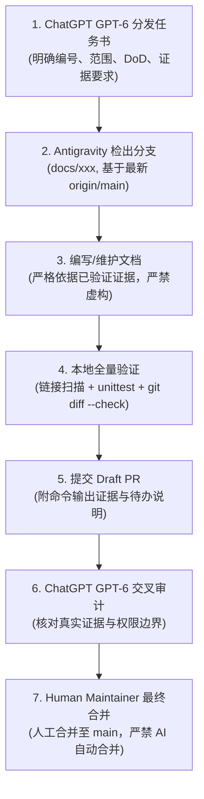

# LexRouter 文档基线与维护手册（Antigravity Baseline）

* 文档版本：v1.0  
* 初始化日期：2026-10-31  
* 基准 Commit SHA：`0cf2072b455eb5719bc1a5d455305ee00b188167`  
* 基准提交信息：`docs(gov): establish LexRouter multi-agent collaboration V2 (#17)`  
* 维护角色：Antigravity (Documentation Owner)  
* 关联任务：[LR-AG-INIT-01](daily-specs/LR-AG-INIT-01.md)  

---

## 一、Antigravity 职责与权限边界

根据主仓库 `AGENTS.md`（V2 协作规范），团队分工确立了 **单任务负责人（Single Owner）+ 交叉复核（Cross Review）+ 人工验收（Human Gate）** 机制。Antigravity 作为 **Documentation Owner**，职责与权限边界如下：

### 1. 核心职责
1. **Document Sync（文档同步）**：根据主分支已合并代码、已验证工程 PR、真实测试日志及 CI 运行证据，及时同步更新项目文档。
2. **Documentation Quality（文档质量）**：优化文档层次结构、强化中文专业可读性、规范 Markdown 排版格式、确保全库交叉引用与链接有效性。
3. **Project Records（项目记录）**：维护每日任务索引（`docs/daily-specs/`）、阶段里程碑交接记录、合规与审计证据快照。
4. **Cross-Agent Handoff（多 Agent 协作交接）**：接收 ChatGPT GPT-6（协调与审计）、Codex Astra（架构与 CI）、DeepSeek Harness（自动化发现与辅助工程）的真实变更证据，进行文档化归档与索引，不要求人类维护者手工搬运。

### 2. 权限刚性红线（Strict Non-Goals）
1. **不修改冻结战略**：严禁自行修改 [ROADMAP.md](../ROADMAP.md) 中的 Gemini V3.3 战略定位、三阶段范围、四类榜单或排期。
2. **不擅改正式规范**：不得自行修改正式八字段 Schema（[schemas/skill.schema.json](../schemas/skill.schema.json)）或评测协议（[docs/EVAL_PROTOCOL.md](EVAL_PROTOCOL.md)）。
3. **不接管工程与测试**：不编写核心业务代码、不修改测试断言、不修改 CI 配置。
4. **不作法律与授权判断**：不对第三方 Skills 进行版权授权批准，不替代真人法律专家做出专业判断或资质背书。
5. **不代签与不虚假宣称**：严禁代真人签署 Review 决定；绝不将未合并 PR（如 PR #9, #10, #11, #13）或草案表述为已完成、已上线；绝不将 AI 预审表述为法律专家批准。
6. **不提交敏感数据**：绝不向公开仓库提交密钥、真实敏感未脱敏卷宗或 Holdout 盲测集数据。
7. **不违规操作 Git**：不直接推送到 `main`、不强制推送（force push）、不自行合并 PR 或擅自关闭 Issue。
8. **不提前启动后续阶段**：不提前启动 Phase 2（Lex-Data-Router）或 Phase 3（Lex-Model-Router）开发。

---

## 二、项目核心文档地图

| 层次 | 核心文档 | 权威定位与核心用途 |
| --- | --- | --- |
| **战略与治理层** | [ROADMAP.md](../ROADMAP.md) | Gemini V3.3 冻结路线图（战略最高基准，包含三阶段产品范围与 42 天里程碑） |
| | [AGENTS.md](../AGENTS.md) | AI Agent 协作规范 V2（角色矩阵、单 Owner 责任、三方复核与 Gate 契约） |
| | [CONTRIBUTING.md](../CONTRIBUTING.md) | 社区贡献指南、三轨收录说明与 PR 提交规范 |
| | [SECURITY.md](../SECURITY.md) | 安全与漏洞报告规范、敏感数据保护防线 |
| **元数据与发现层** | [docs/SCHEMA.md](SCHEMA.md) | 法律 Skill 元数据八字段规范 v1 及强类型约束 |
| | [schemas/skill.schema.json](../schemas/skill.schema.json) | 正式 Skill JSON Schema Draft 2020-12 定义 |
| | [docs/DISCOVERY_PROTOCOL.md](DISCOVERY_PROTOCOL.md) | 候选发现协议 v1 及 DeepSeek Harness 自动化 Discovery 分工（LR-GOV-01） |
| | [docs/SKILL_INTAKE_POLICY.md](SKILL_INTAKE_POLICY.md) | A 精选托管 / B 原创研发 / C 外部索引三轨收录政策 |
| | [docs/P1_SELECTION_PLAN.md](P1_SELECTION_PLAN.md) | P1 选品计划与三轨模式提案关联 |
| **评测与合规层** | [docs/EVAL_PROTOCOL.md](EVAL_PROTOCOL.md) | 单一变量控制测评、明暗盲测集隔离与四类排行榜规范 |
| | [docs/ANONYMIZATION.md](ANONYMIZATION.md) | 实务卷宗主体、金额与敏感信息脱敏红线 |
| | [docs/DEPENDENCIES.md](DEPENDENCIES.md) | 直接依赖版本与第三方许可证合法性审计 |
| **专业复核工作台** | [docs/review-workbench/README.md](review-workbench/README.md) | Review Workbench v1 契约、状态流转与初始 3 个候选工作包 |
| | [docs/review-workbench/MAINTAINER.md](review-workbench/MAINTAINER.md) | 人类维护者/审查专家 Markdown 审阅与 GitHub 留证操作指南 |
| | [docs/review-workbench/CONTRACT.md](review-workbench/CONTRACT.md) | 工作台工程契约、四轴独立状态机与 CLI 规范 |
| | [docs/review-workbench/v2/](review-workbench/v2/) | Review Workbench v2 规范、短表格式（Gate 1 已合并；Gate 2 待专家复核） |
| | [docs/reviews/README.md](reviews/README.md) | P0-05 逐文件预审材料清单与交接边界（非法律批准） |
| **任务与历史基线** | [docs/daily-specs/README.md](daily-specs/README.md) | 每日开发任务书总索引 |
| | [docs/P0_ACCEPTANCE_REPORT.md](P0_ACCEPTANCE_REPORT.md) | P0 工程规范实证验收准备报告 |
| | [docs/P1_READINESS.md](P1_READINESS.md) | 首批 10 条候选证据审计与专业复核交接准备 |
| | [docs/P1_BATCH_01_REVIEW.md](P1_BATCH_01_REVIEW.md) | P1 批次 01 审核表、检索记录与人工去重依据（累计 20 条候选） |
| | `docs/ANTIGRAVITY_DOCS_BASELINE.md` | 本文档：文档基准、审计记录与维护流程规范 |

---

## 三、文档更新证据优先级（Hierarchy of Truth）

为杜绝“文档与工程脱节”、“AI 臆测当做事实”或“计划等同于已上线”，Antigravity 在编写与更新文档时严格遵循以下证据优先级：

```
Level 1: main 分支已合并代码/数据与 CI 证据（绝对事实）
   ↓
Level 2: 独立 PR 的工程实现与可复现验证命令（待审事实）
   ↓
Level 3: 冻结路线图与规范文档中的目标定义（目标依据）
   ↓
Level 4: 原始作者声明与公开网页自述（待核查线索）
   ↓
[禁止采信]: 未经运行的口头推断 / AI 代签代批结论（无效伪证据）
```

1. **Level 1（主分支基准事实）**：已合并至 `main` 的文件、代码接口、Schema、数据文件以及 GitHub Actions CI 真实通过日志。文档必须以此为现状描述的唯一核心依据。
2. **Level 2（待审变更事实）**：通过独立分支与 PR 提交的改动，必须附带本地真实运行的验证命令与无截断输出证据。在 PR 未合并前，文档中必须明确标注为“待审核（Draft / Pending Review）”，严禁提前标记为“已完成”。
3. **Level 3（战略基准与目标）**：`ROADMAP.md`、`AGENTS.md` 规定的目标、里程碑周期与产品边界，代表设计指导，但不能替代功能已落地的证据。
4. **Level 4（第三方线索）**：上游项目的 README、许可声明、作者头衔等仅作为发现线索，记录为 `source-declared`，未经法律复核不得升为 `verified`。
5. **绝对禁止**：严禁以 CI 校验通过推定法律有效性；严禁以 AI 预审材料冒充专家签署；严禁在缺乏真实运行输出的情况下宣称测试通过。

---

## 四、首次文档基线审计结果

在 2026-10-31 初始化基准 Commit `0cf2072` 上，Antigravity 执行了全库文档审计，检查结果分为三类：

### 1. Confirmed（已确认需记录或修正的事项）
- **C-01｜Markdown 相对链接与锚点完整性**：
  - 全仓库 58 个 Markdown 文件、531 个相对文件链接与锚点经自动化脚本全面扫描，**有效率 100%，无死链，无失效相对路径**。
- **C-02｜合规红线与签署状态检查**：
  - 检查全库所有涉及审查工作台与候选数据的文档，均严格标注了 `READY_FOR_REVIEW — HUMAN_APPROVAL_PENDING`、`未签署、未入库`、正式 `skills/` 条目数为 0；未发现将 AI 预审冒充真人签署或专家批准的违规表述。
- **C-03｜`docs/daily-specs/README.md` 索引滞后**：
  - 原索引仅记录至 `LR-P1-01`，未收录已合并的 `LR-P1-02` (PR #7)、`LR-P1-03` (PR #8)、`LR-P1-04R` (PR #15)、`LR-GOV-01` (PR #17) 以及待审的 `LR-P1-04A/B/C` (PR #9/#10/#11)。本次初始化任务已予以补充对齐。
- **C-04｜`tests/README.md` 未反映 v2 测试套件**：
  - PR #15 新增了 `test_review_workbench_v2.py`、`test_review_workbench_v2_not_applicable.py`、`test_review_workbench_v2_sync_run.py`，但在 `tests/README.md` 中尚未补充说明。
- **C-05｜`README.md` 文档入口与本地命令需增补**：
  - `README.md` 缺少 Review Workbench v2 文档目录链接；本地检查列表未包含 `python scripts/review_workbench_v2.py validate`。

### 2. Needs Evidence（缺少环境证据或特定平台注意事项）
- **E-01｜macOS 本地测试 `TMPDIR` 软链接路径匹配**：
  - 在 macOS 环境下执行 `python -m unittest discover -s tests -v` 时，因系统默认 `TMPDIR` 位于 `/var/folders`（实为 `/private/var/folders` 的软链接），`scripts/review_workbench.py` 中的 `validate_record` 内部执行 `p.relative_to(root)` 时，因 `root` 未统一解析为 resolve 真实路径而 `p` 被解析，在 Python 3.11/3.14 下会触发路径前缀不匹配异常（5 项失败）。
  - **验证结论**：通过显式指定 `TMPDIR=/private/tmp`，全部 168 项单元测试 100% 通过（Ran 168 tests, OK）。建议在后续文档及环境说明中明确标注 macOS 运行建议。

### 3. Needs Decision（需 ChatGPT GPT-6 或 Human Maintainer 决策）
- **D-01｜`README.md` 进展状态正文更新**：
  - `README.md` 第 14 行目前表述为“当前按 LR-P1-01 开展 P1 发现准备”，但主分支已合并至 LR-P1-04R 及 LR-GOV-01。鉴于该段落涉及项目对外整体形象与阶段定位，建议由 ChatGPT GPT-6 审定更新文案后，再由 Antigravity 统一同步，避免越权改写。
- **D-02｜未合并 PR #13 处理**：
  - PR #13（`docs: 确立 LexRouter Phase 1 证据优先战略主张`）保持 Open 状态达 11 天，需由 ChatGPT GPT-6 或 Human Maintainer 确认是否合并或整合进主分支文档。
- **D-03｜PR #9、#10、#11（LR-P1-04A/B/C）推进节点**：
  - 三个候选技能的真实法律专业复核目前处于 Draft PR 阶段，等待人类专家通过 GitHub Review 机制完成实质审查与签署。

---

## 五、待修复问题清单与建议 Owner

| 编号 | 事项 | 类别 | 建议处理方式 | 建议 Owner | 审核/验收方 |
| --- | --- | --- | --- | --- | --- |
| FIX-01 | 更新 `docs/daily-specs/README.md` 补全 LR-P1-02 ~ LR-GOV-01 记录 | Confirmed | 本次 LR-AG-INIT-01 直接修复 | Antigravity | ChatGPT GPT-6 |
| FIX-02 | 补全 `tests/README.md` 中关于 Review Workbench v2 单元测试的说明 | Confirmed | 后续提交文档 PR 补充 | Antigravity | Codex Astra / ChatGPT |
| FIX-03 | 补充 `README.md` 的 v2 文档入口与 `review_workbench_v2.py validate` 检查命令 | Confirmed | 拟定低风险修订单，随后续文档更新提交 | Antigravity | ChatGPT GPT-6 |
| FIX-04 | macOS 本地测试指南补充 `TMPDIR=/private/tmp` 注意事项 | Confirmed | 写入相关测试与贡献指南 | Antigravity | Codex Astra |
| DEC-01 | `README.md` 第 14 行阶段性进展文案刷新 | Needs Decision | ChatGPT GPT-6 给出核准文案后提 PR | ChatGPT GPT-6 / Antigravity | Human Maintainer |
| DEC-02 | 决定 PR #13（证据优先战略主张）是否合并 | Needs Decision | 协调审核与合并决策 | ChatGPT GPT-6 | Human Maintainer |
| DEC-03 | 安排 LR-P1-04A/B/C 人类法律专家评审与签署 | Needs Decision | 跟踪评审工作台 Gate 2 签署进展 | Human Maintainer | Human Maintainer |

---

## 六、后续文档交接与审核流程

为确保多 Agent 协作顺畅且文档能够持续反映最新工程现实，后续日常文档维护流程确立如下：



1. **任务下发**：所有文档任务由 ChatGPT GPT-6 依据项目计划或工程合并事实统一下发，明确指定任务 ID、工作范围及所需证据。
2. **证据交接**：
   - Codex Astra / DeepSeek Harness 完成工程变更后，必须向 Antigravity 提供实际合并 Commit SHA、PR 编号、新增/修改文件清单以及本地与 CI 测试真实通过日志。
   - Antigravity 仅在获得可信证据后同步更新文档，拒绝未经测试的文档变更。
3. **独立分支与 Draft PR**：
   - 文档修改一律从最新 `origin/main` 建立独立分支（命名规范：`docs/<task-id>-<slug>`）。
   - 提交 Draft PR，严格附带本地执行验证命令的完整输出。
4. **两级审核**：
   - 一级复核：由 ChatGPT GPT-6 执行 PR 审计与 Gate 检查。
   - 最终验收：由 Human Maintainer 审核并最终合并，AI 不得执行自动合并或代签操作。
