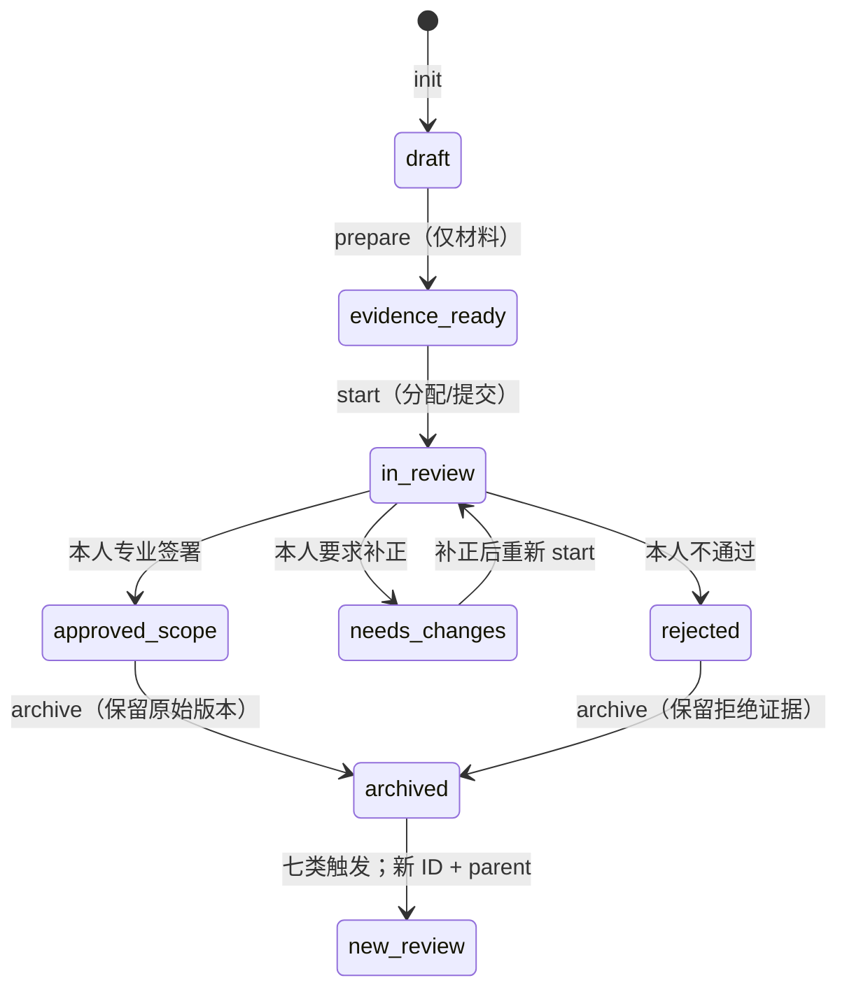

# LexRouter Review Workbench

LR-P1-04R Gate 1 新增 [v2 短表与预审说明](v2/EXPERT_SHORT_FORM.md)、[迁移兼容性报告](v2/PERMISSIONS_AND_MIGRATION.md)和[工程验证证据](v2/VALIDATION.md)。v2 采用独立版本契约，AI 预审、本人专业签署和维护者最终决定分别留证。三个候选仅提供预览；实际迁移等待 Gate 1 工程验收。

以下保留 v1 操作与历史语义，既有四轴记录继续使用原校验器，不能据 v2 规则重解释旧批准。

LR-P1-02 交付仓库原生的持续法律 Skill 复核循环。当前三个实例只完成材料准备：**未专业复核、未签署、法规时效未核实、未获授权批准、未入库**。不建设 Web 后台，不运行上游代码，不复制全文，不改正式八字段 Schema 或 P0 冻结证据。

- [Human Maintainer 操作指南](MAINTAINER.md)：本人填写 Markdown、通过 GitHub 留证；工程命令由 Codex 执行。
- [工程契约与 CLI](CONTRACT.md)：新 Skill、可扩模板、七类触发、历史和签署限制。
- [验证与验收](VALIDATION.md)：T01–T08、D01–D12、复现命令与人工待办。
- [独立 JSON Schema](../../schemas/review-record.schema.json) · [CLI](../../scripts/review_workbench.py) · [模板](../../data/reviews/templates) · [角色白名单](../../data/reviews/reviewers.json)。

## 三个真实待核样本

| 对象 / 初始 Review | 固定拟核范围 | 检查项 | 工作包 |
| --- | --- | --- | --- |
| discovery-contract-review / RV-20261017-contract-review | 27 个文件 | C01–C10 + CR01–CR05 | [开始审阅](../../data/reviews/cases/RV-20261017-contract-review/packet.md) |
| discovery-contract-review-zh / RV-20261017-contract-review-zh | 4 个文件 | C01–C10 + ZH01–ZH05 | [开始审阅](../../data/reviews/cases/RV-20261017-contract-review-zh/packet.md) |
| discovery-china-legal-counsel / RV-20261017-china-legal-counsel | 19 个组件；2,320 项仍排除 | C01–C10 + CN01–CN06 | [开始审阅](../../data/reviews/cases/RV-20261017-china-legal-counsel/packet.md) |

清单沿用 [P0-05](../reviews/P1_LEGAL_REVIEW_HANDOFF.md) 原 commit、blob 和边界；清单快照只含路径/哈希及既有自写摘要，不含上游全文。CR/ZH/CN 是可配置的初始专项实例，核心程序不按候选 ID 或数量分支。

## 状态与角色

图中下划线对应机器值中的连字符：evidence-ready、in-review、approved-scope、needs-changes。归档使用 archived 标记，不重写专业决定。

| 独立维度 | 角色 | 通过值 | 门槛 |
| --- | --- | --- | --- |
| rights_review | Rights Reviewer | approved-scope | A 精确托管权、B 原创性来源、C 索引/描述用途，分别举证 |
| professional_review | Legal Reviewer | approved-scope | 固定版本/范围、事实、官方依据、时间适用、意见和限制 |
| engineering_review | Engineering Reviewer | passed | 八字段元数据、去重、工程检查和 CI 证据 |
| admission_decision | Human Maintainer | admitted | 前三轴汇合后，由维护者独立决定精确范围和用途 |

同一人可以承担全部角色，不要求增加人数；各角色使用独立事件、依据和操作记录。CLI 没有 approve 命令，普通文本/JSON 不充当签署。角色白名单初始为空，须经单独人工接受后启用；不能推定仓库所有者就是专业审核人。

[三轨政策](../SKILL_INTAKE_POLICY.md) 保持有效。工具只记录审批，不添加正式 Skill、不合并 PR。可信重大风险由维护者签署暂停、记录受影响文件并执行处置；不自动删除历史。归档后发现变化或风险，另立子 Review。
